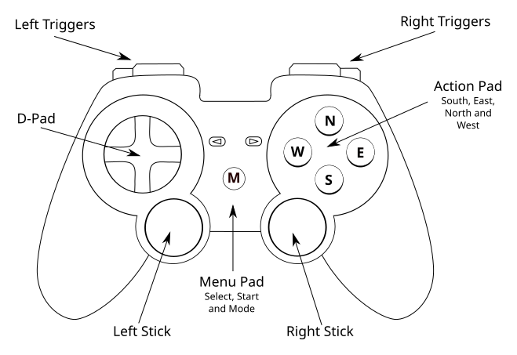
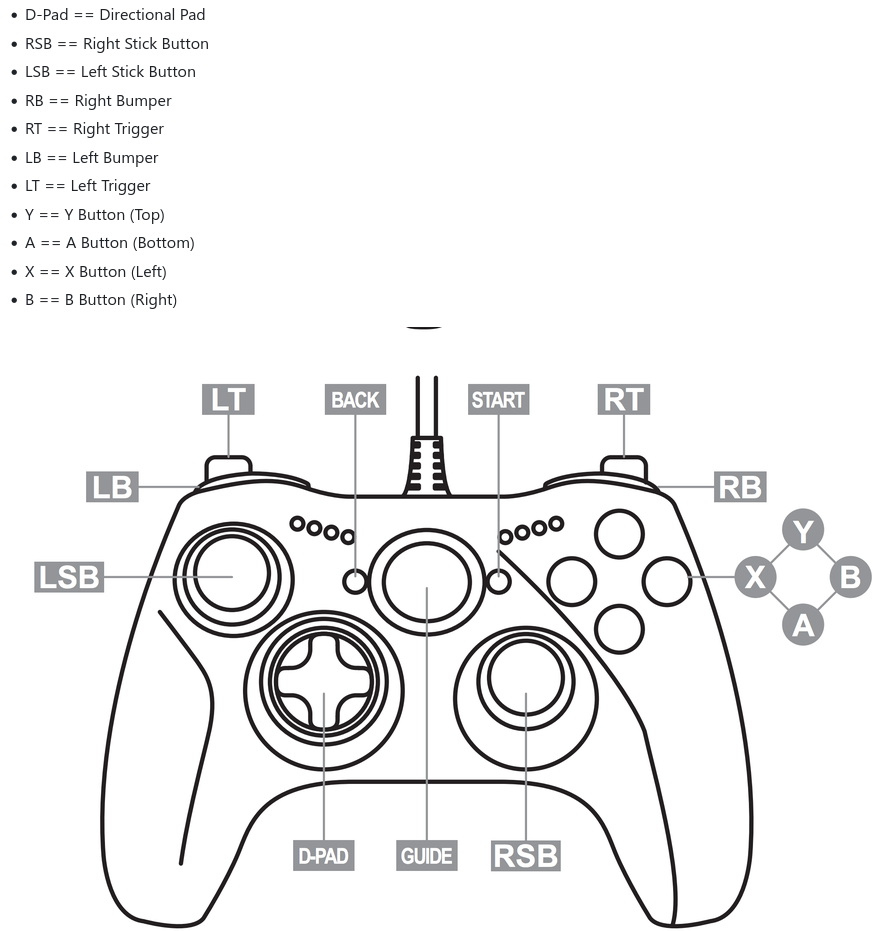

# bikestick

Bikestick is a command line background application that may be used to connect virtual
cycling applications to various Bluetooth game controllers. The controllers 
may then be used for interaction with the application while cycling including virtual gear
changes, steering, braking, camera/view control, and workout control.

Bikestick can be configured to connect to the application by either using the
[OpenBikeControl (OBC)](https://github.com/OpenBikeControl/openbikecontrol-protocol) protocol
if the application supports it, or by inserting keyboard keystrokes into the Operating System (OS)
keyboard buffer (some OS's may require additional configuration and/or permissions).
Note that if using the keyboard connection method then not all options that the application supports
may be available, as some application (MyWhoosh for example) support a small subset of keyboard inputs,
while other (eg TPV) support an almost complete set of keyboard inputs.

Bikestick allows configuration of the button mappings which associates an action in the application (e.g., 
gear change, steering) with a specific button on the controller. You can either use the preset mappings 
provided by bikestick or create your own custom mappings which may also optionally inherit from the preset 
mappings. 
There are three preset mappings, namely `ride`, `race`, and `workout`. You can start bikestick using one of 
these presets or one of your own custom mapping (and also restart bikestick with another mapping, for example 
when you finish a workout and want to switch to a free ride mapping).

The per-application keyboard bindings used when in keyboard connection mode can also be customized in the
event that new keyboard shortcuts need to be defined for a specific application, or a new application needs
to be supported.

## Supported Controllers

- Zwift Play (the original Zwift Play paddles).
- Generic game controllers (Xbox, PlayStation) as supported by
  [gilrs](https://crates.io/crates/gilrs). This also includes many other generic game controllers
  including "tiny" low button-count controllers that can be attached to bike handlebars.
- The newer Zwift Click (encrypted protocol) is **not** currently supported (it should be possible 
  to support it, although it would require connecting to the Zwift Companion application every 24 hours
  \- its unclear as to whether a Zwift subscription would be required).

## Connection Methods

| Method | Description | OS |
|---|---|---|
| `dircon` (alias `network`) | [OpenBikeControl](https://github.com/OpenBikeControl/openbikecontrol-protocol) (OBC) over TCP (WiFi or Ethernet if using a Wahoo Direct connect dongle), advertised via mDNS. To use it the application needs to support OBC and pairing must be carried out within the app. | Linux, Windows, macOS |
| `obc` | OBC as a Bluetooth LE peripheral. Pair it in the app. | Linux only |
| `keyboard` | Virtual keyboard: sends the app's keyboard shortcuts. No pairing, but the application must have keyboard focus. | Linux, Windows, macOS |
| `auto` (default) | All 3 methods are attempted in order given by: DirCon if paired, else OBC Bluetooth, else the keyboard. | all |

Applications with keyboard profiles: TrainingPeaks Virtual (`tpv`), MyWhoosh
(`mywhoosh`), BikeTerra (`biketerra`) and Rouvy (`rouvy`). Zwift has no OBC support, does not have
keyboard shortcuts for steering or virtual gears, and does its own connection to Zwift Plays.
It should be possible to use the keyboard method for non steering and gearing controls though 
(not tested).

Not every action is available everywhere: an app only accepts the OBC buttons it
advertises, and with the keyboard an action needs a key in the app's profile.
`bikestick --doctor` lists mapped actions that have no key in the active profile.

To specify a connection method use the `-c` or `--connection` command line option, as described
below.

## Running the Application

### Command line options

| Option | Description |
|---|---|
| `-C, --config <PATH>` | Use this config file instead of the default location. |
| `-c, --connection <MODE>` | `auto` \| `dircon` (or `network`) \| `obc` \| `keyboard`. |
| `-m, --map <NAME\|PATH>` | Button mapping: a preset (`ride`, `race`, `workout`), a user mapping name, or a file path. Overrides `[mapping] name`. Default `ride`. |
| `-M, --write-map <NAME>` | Copy a built-in mapping to the config directory for editing, print its path, and exit. |
| `--list-maps` | List built-in and user mappings. |
| `-k, --keys <NAME\|PATH>` | Keyboard profile: `tpv`, `mywhoosh`, `biketerra`, `rouvy`, a user profile name, or a file path. Overrides `[keyboard] profile`. Default `tpv`. |
| `-K, --write-keys <NAME>` | Copy a built-in keyboard profile to the config directory for editing, print its path, and exit. |
| `--list-keys` | List built-in and user keyboard profiles. |
| `--write-config` | Write the documented default `config.toml` (to the `-C` path or the default location), print its path, and exit. |
| `--force` | With `--write-config`, `-K` or `-M`: overwrite an existing file. |
| `--print-config` | Print the effective configuration (file + command line) as TOML and exit. The output can be saved and loaded with `-C`. |
| `--doctor` | Check the environment and configuration, then exit. |
| `-v`, `-vv` | Debug / trace logging. |
| `-q` | Warnings and errors only. (`RUST_LOG` overrides `-v`/`-q` and the config.) |
| `--simulate-press <ACTION>` | Send this action (e.g. `shift_up`) every 5 s, for testing without controllers. |
| `--simulate-obc <ID[:VALUE]>` | Send a raw OBC button (e.g. `0x42` or `0x40:0x05`) every 5 s, ignoring the app's declared buttons. For finding out what an app does with a given code. |
| `-h, --help` / `-V, --version` | Help / version. |

On Linux and macOS, `--write-config`, `-K` and `-M` open the written file in
`$VISUAL` (or `$EDITOR`) if set.

### Examples

```sh
bikestick --help                  # Print help
bikestick --doctor                 # check Bluetooth, keyboard injection, gamepads, config path
bikestick                          # run with defaults (auto output, "ride" mapping, TPV keys)
bikestick -c keyboard -k mywhoosh  # keyboard only, MyWhoosh shortcuts
bikestick -m race                  # race preset
```

Exit with Ctrl-C.

## Building a Linux binary for Ubuntu 20.04+

To build a release binary against an Ubuntu 20.04 glibc baseline, use the
Dockerfile at [ancillary/Dockerfile.ubuntu20](./ancillary/Dockerfile.ubuntu20):

```sh
docker build -t ubuntu20-rust-builder -f ancillary/Dockerfile.ubuntu20 .
docker run --rm -v "$PWD":/work \
    -v ubuntu20-rust-cargo-registry:/root/.cargo/registry \
    -v ubuntu20-rust-cargo-git:/root/.cargo/git \
    ubuntu20-rust-builder cargo build --release --locked
```

The built binary is written to `target-docker/release/`.

## Configuration

Everything is optional with built-in defaults. Precedence is
**command line > config file > built-in defaults**.

| OS | Config directory |
|---|---|
| Linux | `~/.config/bikestick/` |
| Windows | `%APPDATA%\{USER}\bikestick\config\` |
| macOS | `~/Library/Application Support/io.github.{user}.bikestick/` |

`bikestick --doctor` prints the exact path. The directory holds:

```
config.toml           # main settings        (create with --write-config)
mappings/<name>.toml  # your button mappings (create with -M <preset>)
keyboard/<name>.toml  # your keyboard profiles (create with -K <app>)
```

A user file with the same name as a built-in one replaces it.

### config.toml

`bikestick --write-config` writes a fully commented template. Sections:

| Section | Settings |
|---|---|
| `[general]` | `output` (connection method), `log_level`, `adapter` (Linux: Bluetooth adapter for the OBC peripheral) |
| `[zwift_play]` | `enabled`, `left_address`/`right_address` (pin specific controllers; the ID is logged when a controller is found: a MAC on Linux/Windows, a UUID on macOS), `paddle_shift_threshold`, `vibrate_on_shift` (vibrate on any delivered paddle action) |
| `[gamepad]` | `enabled`, `stick_engage`/`stick_release` (stick steering thresholds) |
| `[obc]` | `enabled`, `local_name`, `battery_percent` |
| `[obc.camera_views]` | OBC code per camera-view action, e.g. `camera_view_behind = { id = 0x41 }` or `{ id = 0x40, value = 0x02 }` |
| `[dircon]` | `enabled`, `port`, `instance_name` (mDNS name shown in the app) |
| `[keyboard]` | `enabled`, `profile` |
| `[mapping]` | `name` (default mapping), plus `[mapping.zwift_play]` / `[mapping.gamepad]` tables that override individual buttons |

### Button mappings

A mapping says which action(s) each controller button triggers. Presets:

- **ride**: free/route riding,
- **race**: events,
- **workout**: workout controls.

To customise one, run `bikestick -M ride`, edit the file, and select it by name
(`-m ride` now uses your copy) or give it a new name (for example my_ride). 
By default a custom file is created in the `mappings` directory of the config folder, 
and in this case can be used by simply specifying its name with `-m`. If the file is 
saved in another location then the file path (including the .toml extension) must be 
provided when using `-m`. Note when using a custom file name its best to avoid hyphens
which the shell interprets as command line switches. Also if the new name includes
spaces then it should be surrounded by quotes when used on the command line
(eg `-m "my ride"`).

#### Example Usage

```sh
bikestick -M ride
```

Creates a file in `~/.config/bikestick/mappings/ride.toml` (or applicable OS specific config directory) and optionally opens an editor editing the file (if the `EDITOR` or `VISUAL` environment variable is set).

After completing editing and saving the file, you can use the mapping with:

```sh
bikestick -m ride # or the path to a .toml file if the custom file is not located in the config directory
```


#### Mapping File Format

```toml
name = "my-ride"
inherit = "ride" # optional: start from the default ride mapping and override below

[zwift_play]
paddle_right = "shift_up"
paddle_left  = ["shift_down", "decrease_resistance"]   # several actions per button
on_off_left  = "none"                                   # remove a binding

[gamepad]
right_bumper = "shift_up"
```


Gamepad buttons are named by position, not by label: the action pad's four
buttons are `south`, `east`, `north` and `west` (on an Xbox controller A, B, Y
and X), and the triggers are `left_bumper`/`right_bumper` and the analog
`left_trigger2`/`right_trigger2`.





Each preset file lists every button and action name in its header comment. Action
names are matched ignoring case and underscores (`camera_view_behind`,
`CameraViewBehind`).

Default *ride* mapping: [mappings/ride.toml](mappings/ride.toml)

Default *race* mapping: [mappings/race.toml](mappings/race.toml)

Default *workout* mapping:[ mappings/workout.toml](mappings/workout.toml)

Note tiny controllers with limited buttons may require some experimentation
to find which buttons/bumpers/pads etc. are supported.

### Keyboard profiles

A profile maps actions to the app's keyboard shortcuts:

```toml
app = "TrainingPeaks Virtual"
[bindings]
shift_up          = "kp_plus"                              # held while the button is held
camera_view       = { key = "right_bracket", mode = "tap" } # one press per button press
focus_group_ahead = { key = "shift+page_up", mode = "tap" } # modifiers: ctrl, shift, alt, meta/cmd
```
Copy a built-in profile with `bikestick -K tpv`; the header explains the key names.
You can then modify the copied profile and use it with:

```sh
bikestick -k my_profile # bikestick -k path/to/myprofile.toml
```

TPV keyboard map: [keyboard/tpv.toml](keyboard/tpv.toml)

BikeTerra keyboard map: [keyboard/biketerra.toml](keyboard/biketerra.toml)

MyWhoosh keyboard map: [keyboard/mywhoosh.toml](keyboard/mywhoosh.toml)

Rouvy keyboard map: [keyboard/rouvy.toml](keyboard/rouvy.toml)

### Building

[Install Rust](https://www.rust-lang.org/tools/install), then: 

```sh
cargo build --release
```

Executable will be located in `target/release/` in the source directory.


## Platform notes

**Linux**

- Bluetooth uses BlueZ (`bluetoothd` must be running).
- The virtual keyboard uses `/dev/uinput`, which works on X11 and Wayland but
  needs write access. Install the included udev rule and join the `input` group:
  ```sh
  sudo cp udev/99-bikestick-uinput.rules /etc/udev/rules.d/
  sudo udevadm control --reload-rules && sudo udevadm trigger
  sudo usermod -aG input $USER                          # log out and back in afterwards
  echo uinput | sudo tee /etc/modules-load.d/uinput.conf # load uinput at boot
  ```

**Windows**

- Keys are sent as hardware scan codes. Windows blocks key injection into
  applications running as administrator unless bikestick is also elevated.
- The OBC Bluetooth peripheral (`obc`) is not available.

**macOS**

- Grant your terminal (or the bikestick binary) **Bluetooth** access, and
  **Accessibility** access for the keyboard (System Settings → Privacy & Security).
- The OBC Bluetooth peripheral (`obc`) is not available.
